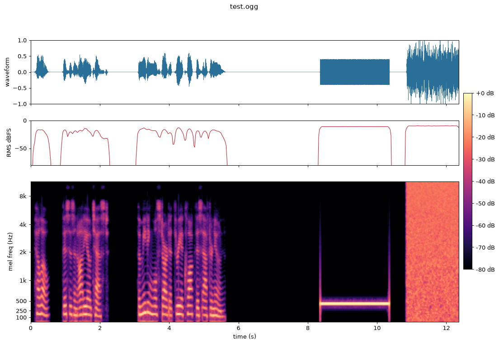

# claude-listen-audio

A [Claude Code](https://claude.com/claude-code) skill that lets Claude **listen** to audio and video files.

Claude can't hear sound, but it can read numbers and look at images. This skill turns a recording into both:

- **Speech → text**: timestamped transcript with [faster-whisper](https://github.com/SYSTRAN/faster-whisper), any language (Turkish included), low-confidence lines flagged
- **Acoustic measurements**: loudness, silence/pauses, clipping, pitch & note, tempo, key, timbre, energy per frequency band, and a timeline of how the sound changes
- **Spectrogram image**: waveform + loudness + mel spectrogram PNG that Claude opens to *see* the sound
- **Sound events** (optional, `--tags`): AudioSet labels such as Dog, Siren, Applause, Guitar per 10 s chunk

Works with mp3, wav, m4a, ogg, flac, opus, webm, mp4… No system ffmpeg needed.



## Install

```bash
git clone https://github.com/digituvacom/claude-listen-audio ~/.claude/skills/listen-audio
python -m pip install -r ~/.claude/skills/listen-audio/requirements.txt
```

On Windows the skills folder is `%USERPROFILE%\.claude\skills\`.

Optional, for sound-event tags:

```bash
python -m pip install transformers torch
```

Restart Claude Code. Then just give it a file: *"What does this say? ~/Downloads/meeting.mp3"*, *"bu kayıtta ne diyor?"*, *"what's the tempo of this song?"*. The skill triggers on its own.

## Run it directly

```bash
python scripts/listen.py recording.mp3 --out ./out
```

| flag | meaning |
|---|---|
| `--mode all\|transcribe\|analyze` | what to do (default `all`) |
| `--model small` | whisper size: `tiny`, `base`, `small`, `medium`, `large-v3`, `turbo` |
| `--language tr` | force language instead of auto-detect |
| `--tags` | add sound-event labels (needs `transformers` + `torch`) |
| `--start 60 --end 120` | only listen to part of a long file |
| `--device auto\|cuda\|cpu` | GPU is used when CUDA 12 libraries are present, otherwise CPU |

Output in `--out`: `report.md` (also printed), `report.json`, `transcript.txt`, `spectrogram.png`.

## Limits

- Whisper doesn't tell speakers apart; "who said what" is inferred from content and pauses.
- Tempo/key are only meaningful for music; the voice-range hint is a rough guess from median pitch.
- First use of a whisper model downloads it (≈150 MB for `base`, ≈500 MB for `small`, ≈1.6 GB for `turbo`).

## License

MIT
