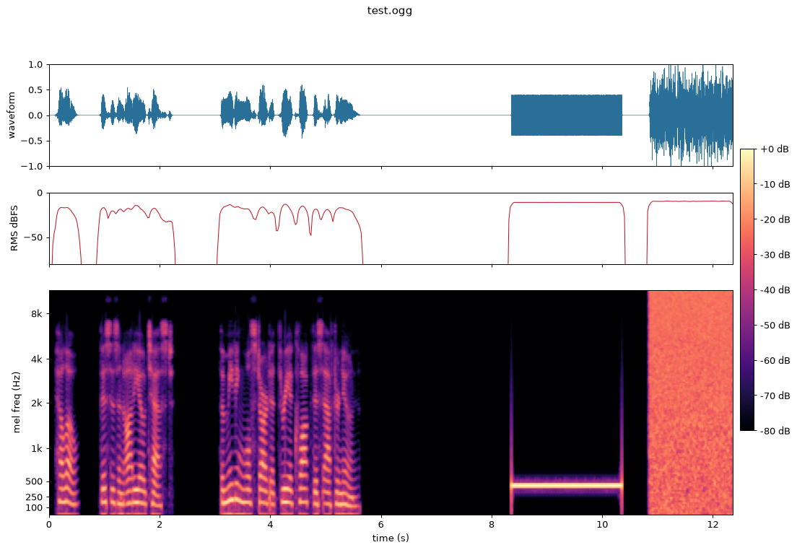
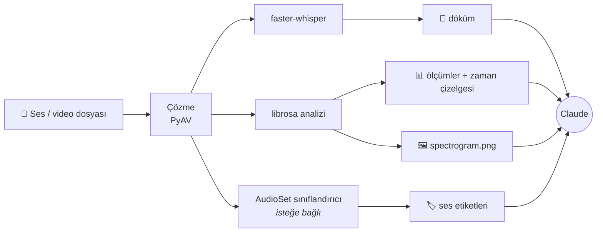

<div align="center">

# 🎧 claude-listen-audio

### Claude'a kulak verin.

Her türlü ses kaydını Claude'un anlayabileceği bir şeye dönüştüren bir [Claude Code](https://claude.com/claude-code) skill'i:<br>
zaman damgalı döküm, hassas akustik ölçümler ve Claude'un gerçekten *bakabildiği* bir spektrogram.

[](https://claude.com/claude-code)
[](https://www.python.org/)
[](https://github.com/SYSTRAN/faster-whisper)
[](LICENSE)

[English](README.md) · **Türkçe**

<a href="https://www.youtube.com/watch?v=XZR8gpV7_Ys"></a>

<sub>▶ <a href="https://www.youtube.com/watch?v=XZR8gpV7_Ys">34 saniyelik tanıtım videosunu izleyin</a> · <a href="https://www.youtube.com/watch?v=knZadfUNXOc">English video</a></sub>

<br><br>



<sub>Tek kayıt, dört ses: konuşma (0–5,7 sn) · sessizlik · saf 440 Hz ton · beyaz gürültü. Claude bu görseli okuyup hepsini birbirinden ayırıyor.</sub>

</div>

---

## İçindekiler

- [Neden](#neden)
- [Claude'a neler sağlar](#claudea-neler-sağlar)
- [Nasıl çalışır](#nasıl-çalışır)
- [Kurulum](#kurulum)
- [Kullanım](#kullanım)
- [Örnek çıktı](#örnek-çıktı)
- [Performans](#performans)
- [Sınırlamalar](#sınırlamalar)
- [Sık sorulan sorular](#sık-sorulan-sorular)
- [Lisans](#lisans)

## Neden

Claude metin okur, görsel görür, ama **duyamaz**. Bir sesli mesaj, toplantı kaydı ya da şarkı verdiğinizde elinde çalışabileceği hiçbir şey olmaz.

Bu skill o boşluğu kapatıyor. Sesi Claude'un en iyi anladığı iki biçime, **sayılara** ve **görsellere** çeviriyor. Böylece şu tür sorulara cevap verebiliyor:

> *"Bu sesli mesajda ne diyor?"* · *"40 dakikalık toplantıyı özetle."* · *"Arka planda gürültü ya da uğultu var mı?"*<br>
> *"Bu parçanın temposu ve tonu ne?"* · *"Müzik kaçıncı saniyede başlıyor?"* · *"Seste patlama (clipping) var mı?"*

## Claude'a neler sağlar

| | Yetenek | Ayrıntı |
|:-:|---|---|
| 🗣️ | **Döküm** | faster-whisper ile zaman damgalı konuşmadan metne çeviri. Türkçe dahil 99 dili kendiliğinden tanır. Emin olunmayan satırlar işaretlenir, kesin bilgi gibi sunulmaz. |
| 📊 | **Akustik rapor** | Ses seviyesi (tepe / RMS / dinamik aralık), patlama (clipping), sessizlikler ve duraklamalar, perde ve nota, tempo (BPM), ton, tını, frekans bantlarına göre enerji. |
| 🕒 | **Zaman çizelgesi** | Sesin pencere pencere nasıl değiştiği: seviye, parlaklık, gürültülülük, vuruşlar, baskın nota. |
| 🖼️ | **Spektrogram** | Dalga formu, ses seviyesi eğrisi ve mel spektrogram tek bir PNG'de. Claude bunu açıp konuşma harmoniklerini, tonları, vuruşları ve gürültüyü *görür*. |
| 🏷️ | **Ses olayları** *(isteğe bağlı)* | 10 saniyelik parçalar için AudioSet etiketleri: köpek, siren, alkış, gitar, korna… 527 sınıf. |

**mp3, wav, m4a, ogg, flac, opus, webm, mp4** ve diğer çoğu ses/video formatıyla çalışır. Sistemde ffmpeg kurulu olması gerekmez.

## Nasıl çalışır



Her şey **kendi bilgisayarınızda** çalışır. Ses hiçbir yere yüklenmez; yalnızca model dosyaları bir kez Hugging Face'ten indirilir.

## Kurulum

### Plugin olarak (önerilen)

Claude Code içinde şunu çalıştırın:

```
/plugin install listen-audio --marketplace digituvacom/claude-listen-audio
```

<sub>Claude Code 2.1.275'ten eski sürümlerde iki adımda: önce `/plugin marketplace add digituvacom/claude-listen-audio`, sonra `/plugin install listen-audio@digituva`.</sub>

Ardından Python bağımlılıklarını bir kez kurun (Python 3.9+):

```bash
python -m pip install faster-whisper librosa matplotlib soundfile
```

İsteğe bağlı, ses olayı etiketleme için:

```bash
python -m pip install transformers torch
```

Güncellemeler `/plugin update listen-audio` ile gelir. Bir bağımlılık eksikse Claude ilk kullanımda fark eder ve neyi kurmanız gerektiğini söyler.

### Düz skill olarak

```bash
git clone https://github.com/digituvacom/claude-listen-audio ~/.claude/skills/listen-audio
python -m pip install -r ~/.claude/skills/listen-audio/requirements.txt
```

<sub>Windows: `%USERPROFILE%\.claude\skills\listen-audio`. Sonrasında Claude Code'u yeniden başlatın.</sub>

## Kullanım

### Claude ile

Dosyadan bahsetmeniz yeterli, skill kendiliğinden devreye girer:

```
> Bu ne diyor? ~/Downloads/sesli-mesaj.m4a
> toplanti.mp3'teki kararları özetle
> Bu kayıtta 50 Hz'lik uğultu var mı?
> parca.wav'ın temposu ve tonu ne?
```

### Komut satırından

```bash
python scripts/listen.py kayit.mp3 --out ./cikti
```

| Parametre | Varsayılan | Açıklama |
|---|---|---|
| `--mode` | `all` | `transcribe` (döküm), `analyze` (analiz) ya da `all` (hepsi) |
| `--model` | `small` | Whisper boyutu: `tiny` · `base` · `small` · `medium` · `large-v3` · `turbo` |
| `--language` | otomatik | Dili sabitler, ör. `tr`, `en`, `de` |
| `--tags` | kapalı | AudioSet ses olayı etiketlerini ekler |
| `--start` / `--end` | tüm dosya | Yalnızca belirli bir aralığı analiz eder (saniye) |
| `--device` | `auto` | `cuda` ya da `cpu`; gerekirse kendiliğinden CPU'ya geçer |
| `--timeline` | `12` | Zaman çizelgesindeki pencere sayısı |

**Çıktılar** `--out` klasörüne yazılır:

```
cikti/
├── report.md        # okunabilir rapor (ekrana da yazdırılır)
├── report.json      # tüm sayılar, makine tarafından okunabilir
├── transcript.txt   # [dd:ss → dd:ss] satırları
└── spectrogram.png  # Claude'un baktığı görsel
```

## Örnek çıktı

<details open>
<summary>Yukarıdaki test kaydı için <b>report.md</b></summary>

```markdown
## Speech
language **en** (p=0.996), 5.8 s of speech, 1 segments, 0 low-confidence

[00:00.00 → 00:05.76] Hello, this is an audio test. The meeting will start at 3 o'clock this afternoon.

## Acoustics
- Loudness: peak 0.0 dBFS, RMS -15.2 dBFS, dynamic range 21.3 dB, clipping 0.031%
- Silence: 35% of the time, 5 sound regions; gaps ≥1s: 00:05.67–00:08.31
- Pitch: voiced 50%, median 194.9 Hz (G3), range D3–A4

### Timeline
| from     | to       | RMS dBFS | centroid Hz | flatness | pitch class |
|----------|----------|----------|-------------|----------|-------------|
| 00:08.24 | 00:09.27 | -11.5    | 442         | 0.0      | A           |  ← 440 Hz ton
| 00:11.33 | 00:12.36 | -9.8     | 5667        | 0.548    | D#          |  ← beyaz gürültü
```

Rapor İngilizce üretilir; Claude size kendi dilinizde, yani Türkçe sorarsanız Türkçe cevap verir.

</details>

## Performans

Varsayılan `small` modeliyle yaklaşık döküm hızı:

| Donanım | Hız |
|---|---|
| NVIDIA GPU (CUDA 12) | gerçek zamanın ~20–40 katı |
| Güncel dizüstü CPU | gerçek zamanın ~1–2 katı |

Her model ilk kullanımda bir kez indirilir: `base` ≈ 150 MB · `small` ≈ 500 MB · `turbo` ≈ 1,6 GB.
İsteğe bağlı etiketleyici ≈ 350 MB indirir.

## Sınırlamalar

- **Konuşmacı ayrımı yok.** Whisper sesleri birbirinden ayırmaz; "kim ne dedi" içerikten ve duraklamalardan tahmin edilir ve tahmin olduğu belirtilir.
- **Konuşmada müzik ölçümleri anlamsızdır.** Tempo ve ton yalnızca müzik için anlamlıdır.
- **Ses ipuçları sadece ipucudur.** Cinsiyet/yaş tahmini yalnızca ortalama perdeye dayanır ve yanılabilir.
- **Perde analizi ilk 90 saniyeyi kapsar**, uzun dosyalar hızlı kalsın diye.

## Sık sorulan sorular

<details>
<summary><b>Ses kaydım bilgisayarımdan çıkıyor mu?</b></summary>

Hayır. Çözme, döküm ve analiz tamamen yerelde çalışır. Tek ağ trafiği, modellerin Hugging Face'ten bir kerelik indirilmesidir.
</details>

<details>
<summary><b>Ekran kartı kullanılmıyor.</b></summary>

faster-whisper, CUDA 12 cuBLAS ve cuDNN kütüphanelerine ihtiyaç duyar. Bunlar yoksa script bir uyarı yazar ve CPU ile devam eder, hiçbir şey bozulmaz.
</details>

<details>
<summary><b>Dökümde yer yer hatalar var.</b></summary>

Daha büyük bir model kullanın (`--model turbo` ya da `large-v3`). Kısa veya karışık dilli kayıtlarda dili `--language tr` ile sabitleyin.
</details>

<details>
<summary><b>2 saatlik bir dosyam var.</b></summary>

İlk bakış için `--start` / `--end` kullanın ya da tamamını arka planda çalıştırın. Claude uzun dosyalarda bunu kendiliğinden yapar.
</details>

## Lisans

[MIT](LICENSE) © 2026 Digituva Yazılım

<div align="center">
<sub>Digituva Yazılım tarafından geliştirildi · <a href="https://github.com/SYSTRAN/faster-whisper">faster-whisper</a>, <a href="https://librosa.org">librosa</a> ve <a href="https://matplotlib.org">matplotlib</a> ile çalışır</sub>
</div>
